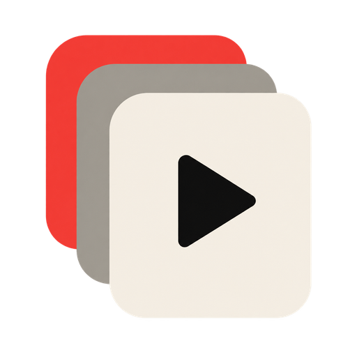

# Custom Lists for Stremio & Nuvio



Bring your movie and series lists into Stremio and Nuvio. Import public MDBList and TMDB lists, or upload WeTrakr and IMDb exports. Your collection lives in your own Upstash Redis database.

**[Open Custom Lists](https://stremio-custom-lists.vercel.app) · [Usage guide](docs/usage.md) · [Development](docs/development.md) · [Architecture](docs/architecture.md)**

## Get started

1. Open the app and connect a dedicated Upstash Redis database with its REST URL and read/write token. Returning users can restore their collection with an existing private install link.
2. Choose **Add a list**. Paste a public list URL, or select a WeTrakr ZIP/CSV or IMDb CSV export.
3. Import the list, then choose **Install addon** to open it in Stremio or copy the link for Nuvio.

This addon provides catalogs, not playback streams. Existing Trakt snapshots remain available without a Trakt subscription or API key.

## Supported sources

| Source        | Import method                        | Credentials           |
| ------------- | ------------------------------------ | --------------------- |
| MDBList       | Public list URL                      | MDBList API key       |
| TMDB          | Public list URL                      | API Read Access Token |
| WeTrakr       | ZIP or CSV export                    | None                  |
| IMDb          | CSV export                           | None                  |
| Trakt archive | Reattach an existing cached snapshot | None                  |

Search, filter, preview, rename, categorize, and reorder lists in the workspace. Sorting the workspace does not change addon order. Refreshes are manual; a failed refresh keeps the previous snapshot.

## Privacy

**Your private install link contains recoverable database credentials. Treat it like a password and never share it.** Share the public homepage instead. Use a dedicated database for this addon.

There is no shared user database, browser-persisted credential store, or analytics. Read [storage and privacy](docs/storage-and-privacy.md) for the storage model, import limits, and hosting considerations.

## Run locally

Use Node.js 24. From the repository root:

```sh
npm run setup
npm run build
npm start
```

The app runs at `http://localhost:7700`. For development, use `npm run dev` and `npm run dev:ui` in separate terminals. Run `npm run check` before submitting changes.

## Repository guide

- [Usage](docs/usage.md): supported URLs, file imports, and legacy Trakt data.
- [Architecture](docs/architecture.md): module boundaries and compatibility rules.
- [Development and deployment](docs/development.md): scripts, Vercel, and CI.
- [Storage and privacy](docs/storage-and-privacy.md): Redis keys, limits, and credentials.
- [Provider references](docs/providers.md): API documentation and attribution.
- [Contributing](CONTRIBUTING.md): local workflow and validation.

This product uses the TMDB API but is not endorsed or certified by TMDB.
